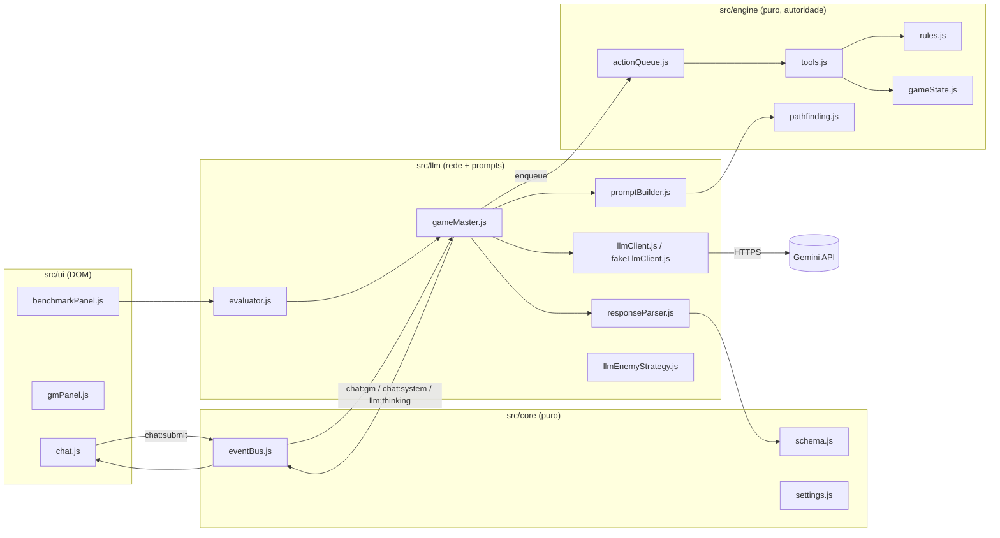
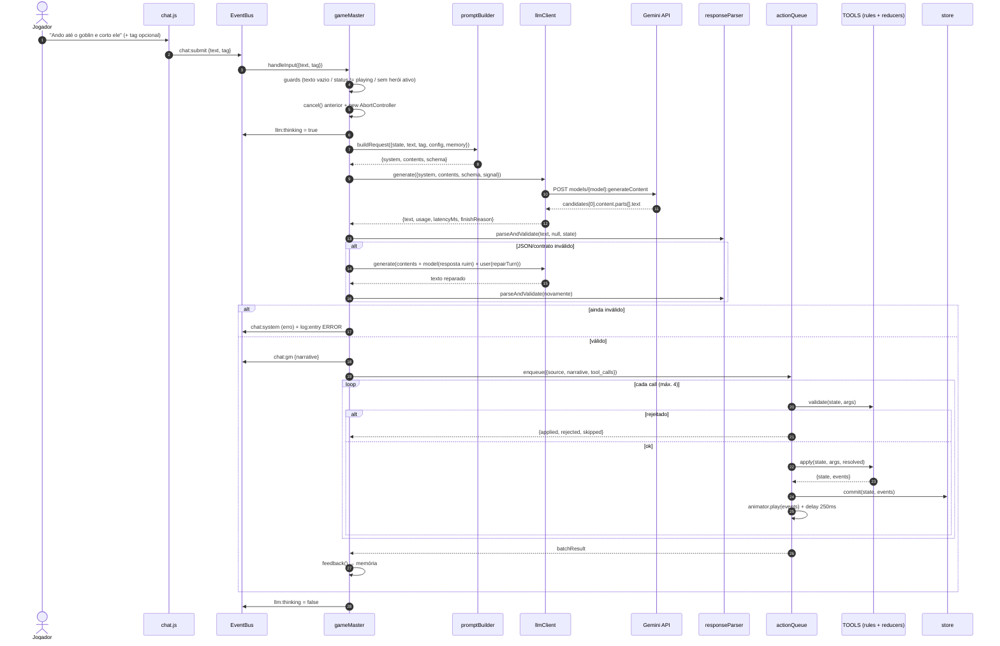
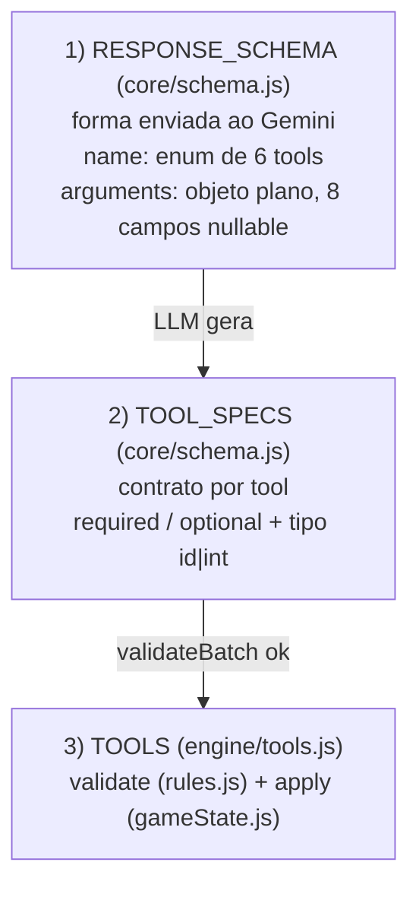
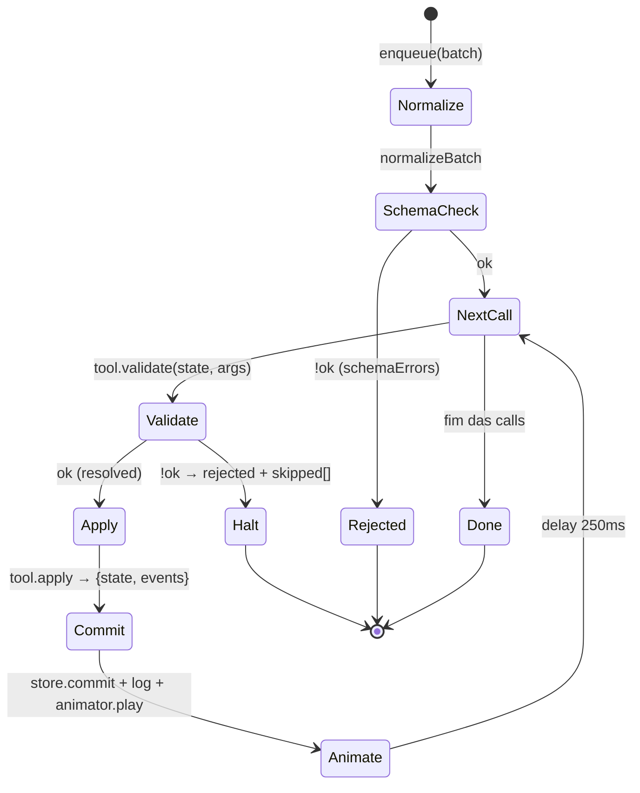

# Workflow Técnico do LLM "Mestre de Jogo" — RPG_LLM

> Documento de apoio para apresentação. Cobre a camada `src/llm/*`, como ela conversa com o motor (`src/engine/*`) e como as "tools" são expostas, validadas e executadas.

---

## 1. Ideia central (o "pitch" técnico)

**O LLM não joga — ele propõe.**
O Gemini recebe um snapshot do estado + o texto livre do jogador (PT-BR) e devolve **um JSON** com:

```json
{ "narrative": "texto imersivo", "tool_calls": [ { "name": "...", "arguments": { ... } } ] }
```

Esse JSON passa por **4 barreiras** antes de alterar o estado:

| # | Barreira | Onde | Tipo de garantia |
|---|----------|------|------------------|
| 1 | `responseSchema` + `responseMimeType: application/json` | API Gemini ([llmClient.js](file:///home/Byuki/Documentos/GitHub/RPG_LLM/src/llm/llmClient.js#L139-L145)) | Decodificação restrita no servidor |
| 2 | Extração tolerante + normalização (aliases, coerção) | [responseParser.js](file:///home/Byuki/Documentos/GitHub/RPG_LLM/src/llm/responseParser.js) + [normalizeBatch](file:///home/Byuki/Documentos/GitHub/RPG_LLM/src/core/schema.js#L96-L302) | Robustez sintática |
| 3 | Validação estrutural por tool (`TOOL_SPECS`) | [validateBatch](file:///home/Byuki/Documentos/GitHub/RPG_LLM/src/core/schema.js#L311-L411) | Contrato de argumentos |
| 4 | Validação de **regras do jogo** (`tool.validate`) | [actionQueue.js](file:///home/Byuki/Documentos/GitHub/RPG_LLM/src/engine/actionQueue.js#L111-L121) → `rules.js` | **Autoridade absoluta** |

Só depois disso `tool.apply` (reducer puro) gera o novo estado.

---

## 2. Mapa de módulos

| Arquivo | Camada | Responsabilidade |
|---------|--------|------------------|
| [gameMaster.js](file:///home/Byuki/Documentos/GitHub/RPG_LLM/src/llm/gameMaster.js) | llm | Orquestrador: input → prompt → LLM → repair → fila → feedback/memória |
| [promptBuilder.js](file:///home/Byuki/Documentos/GitHub/RPG_LLM/src/llm/promptBuilder.js) | llm | System prompt (Config A/B), snapshot determinístico, request Gemini |
| [llmClient.js](file:///home/Byuki/Documentos/GitHub/RPG_LLM/src/llm/llmClient.js) | llm | `fetch` REST ao `generateContent`, timeout, retry, erros tipados |
| [fakeLlmClient.js](file:///home/Byuki/Documentos/GitHub/RPG_LLM/src/llm/fakeLlmClient.js) | llm | Mesma interface, offline (`?fakeLlm=1`), testes e fixtures |
| [responseParser.js](file:///home/Byuki/Documentos/GitHub/RPG_LLM/src/llm/responseParser.js) | llm | Extrai JSON, normaliza envelope, monta turno de reparo |
| [llmEnemyStrategy.js](file:///home/Byuki/Documentos/GitHub/RPG_LLM/src/llm/llmEnemyStrategy.js) | llm | IA dos monstros via LLM com fallback heurístico |
| [evaluator.js](file:///home/Byuki/Documentos/GitHub/RPG_LLM/src/llm/evaluator.js) | llm | Benchmark acadêmico A vs B, métricas, CSV/JSON |
| [schema.js](file:///home/Byuki/Documentos/GitHub/RPG_LLM/src/core/schema.js) | core | `RESPONSE_SCHEMA`, `TOOL_SPECS`, `normalizeBatch`, `validateBatch` |
| [tools.js](file:///home/Byuki/Documentos/GitHub/RPG_LLM/src/engine/tools.js) | engine | Registro `TOOLS = { name: { validate, apply } }` |
| [actionQueue.js](file:///home/Byuki/Documentos/GitHub/RPG_LLM/src/engine/actionQueue.js) | engine | Execução sequencial, *halt-on-first-reject*, animação |
| [settings.js](file:///home/Byuki/Documentos/GitHub/RPG_LLM/src/core/settings.js) | core | `apiKey`, `model`, `promptConfig`, `temperature`, `timeoutMs`, `enemyAIMode` (localStorage) |



O LLM **nunca importa** `rules.js` nem muta o store diretamente: ele só chama `queue.enqueue(...)`, injetada pelo composition root.

---

## 3. Composition root ([main.js](file:///home/Byuki/Documentos/GitHub/RPG_LLM/src/main.js#L105-L156))

Ordem de montagem relevante:

1. `createActionQueue({ store, bus, tools: TOOLS, animator, stepDelayMs: 250 })`
2. Cliente LLM (**injeção de dependência**):
   ```js
   const llm = isFakeLlm
     ? createFakeLlmClient({ responder: () => gmPanel.getSelectedFixtureText() })
     : createLlmClient({ getSettings: loadSettings });
   ```
3. `LlmEnemyStrategy({ llm, bus, fallbackStrategy: heuristic, timeoutMs: 8000 })` → `createEnemyController({ mode, strategies })`
4. `createGameMaster({ store, queue, bus, llm, getSettings })`
5. Handler do chat ([main.js:198-222](file:///home/Byuki/Documentos/GitHub/RPG_LLM/src/main.js#L198-L222)):
   - sem API key (e não fake) → abre modal de Settings;
   - faz echo da mensagem do jogador;
   - `await gm.handleInput({ text, tag, recordPrompt: true })`.

Como `llmClient` e `fakeLlmClient` expõem a mesma interface `{ generate, testConnection }`, o orquestrador não sabe se está online, offline ou em teste.

---

## 4. Pipeline principal — `handleInput` ([gameMaster.js:116-313](file:///home/Byuki/Documentos/GitHub/RPG_LLM/src/llm/gameMaster.js#L116-L313))



### 4.1 Objeto `trace` (telemetria por chamada)

Cada `handleInput` devolve um `trace` ([gameMaster.js:132-153](file:///home/Byuki/Documentos/GitHub/RPG_LLM/src/llm/gameMaster.js#L132-L153)) que é a base do benchmark:

| Campo | Significado |
|-------|-------------|
| `config` / `model` / `source` | `A`/`B`, modelo Gemini, `PLAYER` ou `BENCHMARK` |
| `prompt` | `{system, contents}` (quando `recordPrompt`) |
| `rawFirst` / `rawRepair` | Texto cru da 1ª resposta e do reparo |
| `parsed` | Envelope normalizado `{narrative, tool_calls, flags}` |
| `jsonValidFirstTry` / `repaired` / `coercedArgs` | Qualidade da saída estruturada |
| `schemaErrors` | Erros de contrato se falhou de vez |
| `batchResult` | `{applied[], rejected, skipped[]}` vindo do motor |
| `latencyMs` / `usage` | Somados entre tentativa + reparo |
| `error` | `{kind, message}` (ex.: `timeout`, `auth`, `canceled`) |

### 4.2 Cancelamento

- `bus.emit('gm:cancel')` (botão no chat) → `controller.abort()`.
- Uma nova entrada sempre cancela a requisição pendente anterior (`cancel()` antes de criar o novo `AbortController`).
- O `signal` é propagado ao `llmClient`, que encadeia com o próprio timeout.

---

## 5. Construção do prompt ([promptBuilder.js](file:///home/Byuki/Documentos/GitHub/RPG_LLM/src/llm/promptBuilder.js))

### 5.1 System prompt — `buildSystemPrompt(config)`

Montado por blocos concatenados:

| Bloco | Config A | Config B | Conteúdo |
|-------|:-:|:-:|----------|
| `roleBlock` | ✅ | ✅ | Papel de Mestre, narrativa PT-BR 1–3 frases, "você **não** altera o estado" |
| `contractBlock` | ✅ | ✅ | Formato JSON, as 6 tools com argumentos e regras, convenção de coordenadas (norte = y-1), máx. 4 calls, recusa com `tool_calls: []` |
| `spatialBlock` | ❌ | ✅ | "Use **apenas** `reachable_tiles`", "consulte `attack_positions`", "priorize `selected_ui_tag`" |
| `fewShotBlock` | ❌ | ✅ | 3 exemplos PT-BR: mover+atacar, cura, recusa |

> **A vs B é o experimento científico do projeto**: B testa se *pré-computar raciocínio espacial no motor* + *few-shot* melhora a precisão das tool calls.

### 5.2 Snapshot de estado — `buildStateSnapshot(state, config)`

Determinístico (todas as listas ordenadas por `id`; tiles por `cost, y, x`) → prompts reproduzíveis para o benchmark.

**Base (A e B):**
```text
round, active_character{id,name,class,position,hp,max_hp,mp,ap,abilities[{id,name,range,effect}]},
party[], enemies[] (vivos), objects[], inventory[], map_ascii (12 linhas), player_text_pt, selected_ui_tag
```

**Extras da Config B** (calculados pelo motor, via `computeReachable` de `pathfinding.js`):

| Campo | Cálculo | Para quê |
|-------|---------|----------|
| `reachable_tiles` | BFS com custo ≤ MP → `[[x,y,cost],...]` | Elimina alucinação de destino |
| `enemy_distances` | Manhattan + `in_range_now` por habilidade | Decide se precisa mover |
| `attack_positions` | `{ability: {enemy: [[x,y,cost]]}}` tiles alcançáveis dentro do range | Viabiliza "mover + atacar" em 1 resposta |
| `adjacent_objects` | Objetos a distância ≤ 1 | Baús / lockpick |

> Ponto de apresentação: o LLM é ruim em geometria; o motor é perfeito. **Delegamos a geometria para o motor e a semântica para o LLM.**

### 5.3 Turno do usuário e request final

```text
ESTADO:
{ ...snapshot JSON indentado... }

JOGADOR (Thorin): Ando até o goblin e corto ele
[Tag Ativa: slash]
```

`buildRequest` devolve:
```js
{
  system,                                   // → systemInstruction
  contents: [...memory, { role:'user', parts:[{ text: userTurn }] }],
  schema: RESPONSE_SCHEMA                   // → generationConfig.responseSchema
}
```

---

## 6. Contrato das Tools — como o LLM "fala" com o motor

Este projeto **não usa function calling nativo** do Gemini (`tools`/`functionDeclarations`). Usa **Structured Output**: as tools são um **array dentro do JSON de resposta**, restringido por schema. Vantagens: narrativa + múltiplas ações num único round-trip, compatível com Gemma (sem suporte a schema) e totalmente validável no cliente.

### 6.1 Três representações da mesma tool



1. **[RESPONSE_SCHEMA](file:///home/Byuki/Documentos/GitHub/RPG_LLM/src/core/schema.js#L418-L450)** — `arguments` é um objeto **plano** com todos os campos possíveis (`character_id, caster_id, target_id, ability_id, item_id, object_id, target_x, target_y`), todos `nullable`. Motivo: o `responseSchema` do Gemini não lida bem com `oneOf` por tool; um objeto plano estabiliza a saída e os nulos são descartados depois.
2. **[TOOL_SPECS](file:///home/Byuki/Documentos/GitHub/RPG_LLM/src/core/schema.js#L7-L68)** — contrato fino:

   | Tool | Obrigatórios | Custo / regra principal |
   |------|-------------|-------------------------|
   | `move_character` | `character_id`, `target_x`, `target_y` | MP = passos do caminho |
   | `use_ability` | `caster_id`, `ability_id`, `target_id` | 1 AP, range + linha de visão |
   | `use_item` | `character_id`, `item_id` (`target_id` default = self) | livre |
   | `interact_object` | `character_id`, `object_id` | adjacente (Manhattan 1) |
   | `check_inventory` | `character_id` | livre |
   | `end_turn` | `character_id` | só se o jogador pedir |

3. **[TOOLS](file:///home/Byuki/Documentos/GitHub/RPG_LLM/src/engine/tools.js)** — `Object.freeze({ name: { validate, apply } })`. `validate` retorna `{ ok, code, message, resolved }`; `apply` é reducer puro `(state, args, resolved) → { state, events }`.

### 6.2 Normalização tolerante — [normalizeBatch](file:///home/Byuki/Documentos/GitHub/RPG_LLM/src/core/schema.js#L96-L302)

Corrige "deslizes" comuns de LLM e marca `coerced: true` (vira métrica):

- **Nomes de tool:** `attack|strike|cast_ability → use_ability`, `move|walk|move_to → move_character`, `open|interact|open_chest → interact_object`; trim + lowercase.
- **Argumentos:** remove `null`/`""`; `"5"` → `5` em campos `int`; `character_id ↔ caster_id`; `target|enemy_id → target_id`; `ability|skill → ability_id`; `item → item_id`.
- **Resolução contextual (com `state`):**
  - `caster_id` ausente → `state.activeId`;
  - `ability_id` ausente → 1ª habilidade do herói;
  - `target_id` ausente + `(target_x,target_y)` → entidade/objeto naquela casa;
  - ainda ausente → inimigo adjacente de **menor HP**;
  - `interact_object` sem `object_id` → objeto adjacente.

> Essa resolução é uma *heurística de conveniência*. Ela pode "adivinhar" um alvo, mas **o motor continua validando**, então nunca gera um efeito ilegal.

### 6.3 Validação estrutural — [validateBatch](file:///home/Byuki/Documentos/GitHub/RPG_LLM/src/core/schema.js#L311-L411)

- `tool_calls` precisa ser array; **máx. `CONFIG.MAX_TOOL_CALLS = 4`** (`TOO_MANY_CALLS`).
- `UNKNOWN_TOOL`, argumentos obrigatórios ausentes, tipos `id` (string não vazia) / `int` (inteiro).
- Argumentos desconhecidos são rejeitados, **exceto** os campos do schema plano (`RESPONSE_SCHEMA_FIELDS`), que são ignorados como ruído benigno.
- Retorna `{ ok, errors[], calls }`.

---

## 7. Cliente Gemini ([llmClient.js](file:///home/Byuki/Documentos/GitHub/RPG_LLM/src/llm/llmClient.js))

### 7.1 Request HTTP

```http
POST https://generativelanguage.googleapis.com/v1beta/models/{model}:generateContent
Content-Type: application/json
x-goog-api-key: <apiKey do localStorage>
```

Corpo montado por [buildRequestBody](file:///home/Byuki/Documentos/GitHub/RPG_LLM/src/llm/llmClient.js#L109-L164):

```json
{
  "systemInstruction": { "parts": [{ "text": "<system prompt>" }] },
  "contents": [ { "role": "user|model", "parts": [{ "text": "..." }] } ],
  "generationConfig": {
    "temperature": 0.2,
    "maxOutputTokens": 2048,
    "responseMimeType": "application/json",
    "responseSchema": { "...RESPONSE_SCHEMA..." },
    "thinkingConfig": { "thinkingLevel": "low" }
  }
}
```

- `thinkingConfig`: `gemini-2.5-flash` → `thinkingBudget: 0`; `gemini-3*` → `thinkingLevel: 'low'` (latência baixa para um jogo).
- **Fallback Gemma** (`/gemma/i`): sem `systemInstruction` nem `responseSchema` → o system prompt é **prefixado no 1º turno do usuário** + instrução "responda estritamente com JSON". Nesse caso o parser tolerante faz o trabalho do schema.
- `normalizeContents` aceita `{role, parts}` ou `{role, text}` e força `role ∈ {user, model}`.

### 7.2 Resiliência

| Mecanismo | Implementação |
|-----------|---------------|
| Timeout | `AbortController` interno + `setTimeout(timeoutMs)` (default 30 s, configurável) |
| Cancelamento externo | `signal` do GM encadeado ao controller interno |
| Retry transitório | **1 retry** em `429/500/503`; delay 1,5 s ou `Retry-After` (429); aborta se cancelado durante a espera |
| Erros tipados | `LLMError.kind`: `auth` (401/403), `model` (404), `rate_limit`, `server`, `timeout`, `network`, `blocked` (`SAFETY`), `truncated` (`MAX_TOKENS`), `canceled` |
| Mensagens | Todas em PT-BR, prontas para o chat |
| Telemetria | `latencyMs` (performance.now) + `usageMetadata` |

Saída: `{ text, finishReason, usage, latencyMs }`; `text` é a concatenação de `candidates[0].content.parts[].text`.

`testConnection()` faz um "ping" com `maxOutputTokens: 10` e timeout de 10 s para o modal de Settings.

---

## 8. Parser e reparo ([responseParser.js](file:///home/Byuki/Documentos/GitHub/RPG_LLM/src/llm/responseParser.js))

`parseAndValidate(text, customTools, state)` = `extractJson → normalizeEnvelope → validateBatch`.

### 8.1 `extractJson` — cascata de estratégias
1. `trim` + remove cerca Markdown externa (```` ```json ... ``` ````) → `JSON.parse`.
2. Cerca Markdown **embutida** em texto conversacional → `JSON.parse`.
3. [extractJsonBlock](file:///home/Byuki/Documentos/GitHub/RPG_LLM/src/llm/responseParser.js#L13-L48): scanner de chaves balanceadas **ciente de strings e escapes** (não se confunde com `}` dentro de `"narrative"`).
4. Falha → erro tipado (`Nenhum objeto JSON encontrado` / `JSON inválido: ...`).

### 8.2 `normalizeEnvelope`
- `narrative` truncada em **1200 chars**.
- Aliases do array: `toolCalls | commands | actions` → `tool_calls` (`flags.aliasUsed`); array "nu" também aceito.
- `arguments` vindo como **string JSON** → `JSON.parse` (`flags.coerced`). Aceita `args` como alias.
- Aplica `normalizeBatch(..., state)`.

### 8.3 Repair de 1 tentativa (*1-shot self-correction*)

Se a 1ª resposta falhar no parse/contrato, o GM reenvia o histórico com a resposta ruim **como turno do modelo** e um turno de correção ([buildRepairTurn](file:///home/Byuki/Documentos/GitHub/RPG_LLM/src/llm/responseParser.js#L194-L202)):

```text
[... contents originais ...]
model: <resposta inválida>
user : Sua resposta anterior não era um JSON válido no contrato (erro: <msg>).
       Responda SOMENTE com o objeto JSON {"narrative": "...", "tool_calls": [...]}. ...
```

O erro concreto é devolvido ao modelo, o que aumenta a taxa de correção. São **no máximo 2 chamadas** por input, o que limita custo e latência.

---

## 9. Execução autoritativa — ActionQueue ([actionQueue.js](file:///home/Byuki/Documentos/GitHub/RPG_LLM/src/engine/actionQueue.js))



- **Fila FIFO serializada** (`jobs[]` + `pump()`): lotes de jogador, inimigos e hotkeys nunca se intercalam.
- **Validação contra o estado corrente**: cada call valida sobre o estado *após* as anteriores. Exemplo: o `move` gasta MP e o `use_ability` seguinte já é checado na nova posição.
- **Halt-on-first-reject**: as calls seguintes vão para `skipped`. Não há execução parcial "fora de ordem".
- Emite `queue:busy`, `queue:batchDone` e `log:entry` (via `describeEvent`).
- O benchmark desliga animação (`setAnimator(null)`) e delay (`setStepDelay(0)`).

---

## 10. Memória conversacional e feedback do motor

[feedback()](file:///home/Byuki/Documentos/GitHub/RPG_LLM/src/llm/gameMaster.js#L52-L105) cria um **loop de feedback do motor para o LLM**:

```text
user : [Jogador 1 · Thorin] Ando até o goblin e corto ele [Tag Ativa: slash]
model: {"narrative":"...","tool_calls":[...],"flags":{...}}
user : [MOTOR] OK: move_character, use_ability
       — ou —
user : [MOTOR] REJEITADO use_ability: Alvo fora de alcance. Nenhuma ação posterior foi executada.
       — ou —
user : [MOTOR] Nenhuma ação solicitada.
```

- Janela deslizante de **6 entradas** (`memory.slice(-6)`), cerca de 2 turnos.
- A memória guarda **só o texto do jogador**, não o snapshot. Isso economiza tokens, já que o estado atual sempre vai completo no último turno.
- Rejeições também viram `chat:system` (exceto no benchmark).
- `intent:reset` (novo jogo) limpa a memória; o evaluator chama `resetMemory()` entre casos para evitar vazamento entre eles.

---

## 11. Eventos do EventBus envolvidos

| Evento | Emissor → Consumidor | Payload / efeito |
|--------|---------------------|------------------|
| `chat:submit` | chat.js → main.js | `{text, tag}` → `gm.handleInput` |
| `gm:cancel` | chat.js → gameMaster | aborta a requisição |
| `llm:thinking` | gameMaster → chat.js | `true/false` (spinner / desabilita input) |
| `chat:gm` | gameMaster → chat.js | `{narrative}` (renderizado com `textContent`) |
| `chat:system` | gameMaster/main → chat.js | `{level, text}` erros, recusas, cancelamento |
| `log:entry` | GM / queue / client → activityLog | `{level, text, source, ts}` |
| `queue:busy` / `queue:batchDone` | actionQueue → chat/gmPanel | trava UI durante a execução |
| `intent:enqueue` | gmPanel / hotkeys → queue | ações manuais (sem LLM) |
| `intent:reset` | UI → main + GM | reinicia estado e memória |
| `settings:changed` | settings → main/turnBar | troca `enemyAIMode`, badge do modelo |

O painel GM (debug) lê `gm.getLastPrompt()` e `gm.getLastRawResponse()` para inspeção ao vivo, um bom recurso para demo.

---

## 12. IA inimiga via LLM ([llmEnemyStrategy.js](file:///home/Byuki/Documentos/GitHub/RPG_LLM/src/llm/llmEnemyStrategy.js))

Mesmo padrão, contrato reduzido:

- `buildMonsterRequest(state, enemyId)`: system prompt de "IA tática", snapshot com `monster_id`, `reachable_tiles`, `adjacent_heroes`, `living_heroes`; só `move_character` e `use_ability(goblin_strike)`.
- Pós-processamento: **filtra calls cujo ator ≠ `enemyId`** (anti-hijack), valida schema e regras, timeout de 8 s.
- **Qualquer falha → `HeuristicEnemyStrategy`** (degradação graciosa). O `enemyController` enfileira na mesma `actionQueue` com `source: 'ENEMY_AI'`.

---

## 13. Benchmark acadêmico ([evaluator.js](file:///home/Byuki/Documentos/GitHub/RPG_LLM/src/llm/evaluator.js#L555-L648))

Para cada `config ∈ {A,B}` × `rep` × `case`:
1. `store.reset(buildSnapshot(tc.snapshot, seed))` + `withActive(...)` → estado conhecido.
2. `gm.resetMemory()`.
3. `gm.handleInput({ text: tc.prompt_pt, tag, source: 'BENCHMARK', configOverride: config })`, que força **`temperature: 0`** e silencia o chat.
4. `scoreCase(tc, trace)`:
   - `toolCorrect` (sequência de tools = esperada, com alternativas);
   - `argMatched/argTotal` (inclui matcher `target_xy_in: attack_positions:<ab>:<enemy>`);
   - `llmRefused` (caso ilegal sem tool que muda estado);
   - `engineRejected`, `illegalEffectApplied`;
   - `jsonValidFirstTry`, `repaired`, `coercedArgs`, `latencyMs`.
5. Delay entre casos (`benchmarkDelayMs`, default 4 s) por causa do rate limit.
6. `finally`: restaura estado, animador e delay originais.

Exporta CSV/JSON com `summarize` (taxas, percentis de latência). Isso fecha o ciclo: **o mesmo pipeline do jogo é o objeto medido**.

---

## 14. Garantias de engenharia (slide "por que é seguro")

- **Autoridade do motor:** LLM → JSON → fila → `rules.js`. Nenhum caminho do LLM chega ao store sem `validate`.
- **Camadas estritas:** `src/llm` só importa `core` e seletores read-only do engine (`pathfinding`, `toAscii`, `catalog`).
- **Determinismo:** snapshot ordenado, `temperature: 0` no benchmark, PRNG com seed no engine.
- **Sanitização:** narrativa e erros exibidos via `textContent`, sem `innerHTML`.
- **Segredo:** `apiKey` só no `localStorage`, enviada em header (`x-goog-api-key`), não na URL.
- **Testabilidade:** `fakeLlmClient` + `fetchImpl` injetável + fixtures.

---

## 15. Achados da análise (pontos de atenção)

> [!WARNING]
> **`LlmEnemyStrategy` sempre cai na heurística.** O código checa propriedades que não existem:
> - [L88](file:///home/Byuki/Documentos/GitHub/RPG_LLM/src/llm/llmEnemyStrategy.js#L88): `parsed.valid` / `parsed.tool_calls`, mas `parseAndValidate` retorna `ok` / `calls`;
> - [L110](file:///home/Byuki/Documentos/GitHub/RPG_LLM/src/llm/llmEnemyStrategy.js#L110): `batchValidation.valid`, mas `validateBatch` retorna `ok`;
> - [L119](file:///home/Byuki/Documentos/GitHub/RPG_LLM/src/llm/llmEnemyStrategy.js#L119): `ruleCheck.valid`, mas `rules.js` retorna `ok`.
>
> Resultado: lança erro em todo turno e loga "IA inimiga LLM falhou; usando heurística", **mesmo com resposta válida** (e gasta 1 request por inimigo).

> [!WARNING]
> **O timeout de 8 s da IA inimiga não chega ao cliente.** [L76](file:///home/Byuki/Documentos/GitHub/RPG_LLM/src/llm/llmEnemyStrategy.js#L76) chama `llm.generate(req, { signal, overrides })`, mas `generate` aceita **um único objeto**. O 2º argumento é ignorado, então valem o timeout global (30 s) e a temperatura das settings.

> [!NOTE]
> Pontos menores:
> - **Memória cortada por entrada, não por turno:** `slice(-6)` pode começar num turno `model` ou no meio de um trio. Também gera dois turnos `user` consecutivos (`[MOTOR]` seguido de `ESTADO`). A API tolera, mas não é o formato canônico de alternância.
> - **Normalização dupla:** o GM normaliza com `state` e a `actionQueue` normaliza de novo sem `state`. É idempotente e inofensivo, mas é redundante.
> - O `model` turn na memória inclui `flags` (`JSON.stringify(trace.parsed)`), um pequeno ruído de tokens.
> - A auto-resolução de alvo (inimigo adjacente de menor HP) pode mascarar erros do LLM nas métricas de argumentos. Vale citar como limitação no benchmark (já sinalizada por `coercedArgs`).

---

## 16. Roteiro sugerido para a apresentação

1. **Problema:** linguagem natural → ações de jogo válidas e determinísticas.
2. **Arquitetura "LLM propõe, motor dispõe"** (diagrama da seção 2).
3. **Contrato de tools via Structured Output** (seção 6, as três representações).
4. **Pipeline ao vivo** (seção 4) com o painel GM mostrando prompt e resposta crua.
5. **Engenharia de prompt A vs B:** pré-computação espacial + few-shot (seção 5).
6. **Robustez:** parser em cascata, repair 1-shot, retries, erros tipados (seções 7 e 8).
7. **Feedback do motor na memória** (seção 10).
8. **Avaliação científica:** métricas e resultados A vs B (seção 13).
9. **Limitações e trabalhos futuros** (seção 15).
