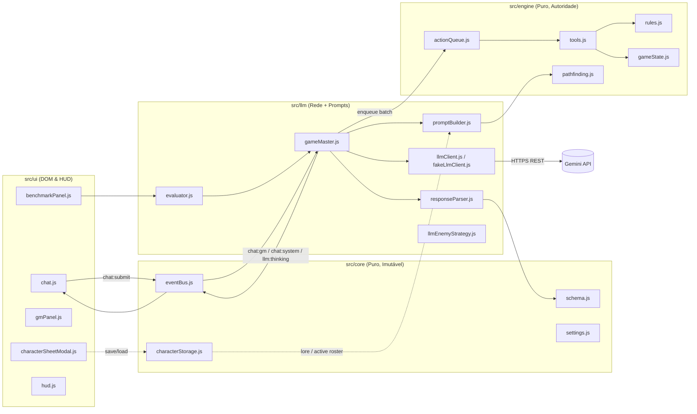
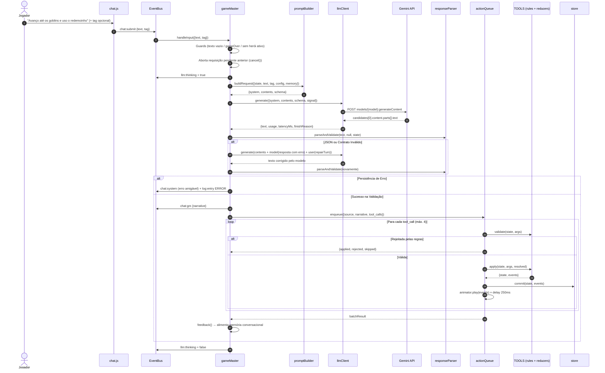
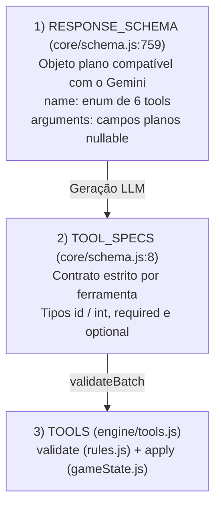

# Workflow Técnico do LLM "Mestre de Jogo" — RPG_LLM

> Documento técnico de apoio arquitetural e apresentação. Cobre detalhadamente a camada `src/llm/*`, como ela interage com o motor determinístico (`src/engine/*`), o ciclo de vida dos prompts, o sistema de fichas/lore, e como as *tools* são expostas, normalizadas, validadas e executadas.

---

## 1. Ideia central (o "pitch" técnico)

**O LLM não joga — ele propõe.**
O Gemini recebe um snapshot determinístico do estado (enriquecido com lore, personalidade e pré-cálculos espaciais) + o texto livre do jogador (PT-BR) e devolve **um JSON estruturado** contendo:

```json
{ 
  "narrative": "texto imersivo contextualizado à personalidade do herói", 
  "tool_calls": [ 
    { "name": "...", "arguments": { ... } } 
  ] 
}
```

Esse JSON passa por **4 barreiras de contenção** antes de alterar qualquer estado da masmorra:

| # | Barreira | Onde | Tipo de garantia |
|---|----------|------|------------------|
| 1 | `responseSchema` + `responseMimeType: application/json` | API Gemini ([llmClient.js](file:///home/Byuki/Documentos/GitHub/RPG_LLM/src/llm/llmClient.js#L139-L145)) | Decodificação sintática restrita no próprio modelo |
| 2 | Extração tolerante + normalização (aliases PT-BR, coerção, semântica) | [responseParser.js](file:///home/Byuki/Documentos/GitHub/RPG_LLM/src/llm/responseParser.js) + [normalizeBatch](file:///home/Byuki/Documentos/GitHub/RPG_LLM/src/core/schema.js#L216-L640) | Robustez sintática e tolerância a variações linguísticas |
| 3 | Validação contratual por tool (`TOOL_SPECS`) | [validateBatch](file:///home/Byuki/Documentos/GitHub/RPG_LLM/src/core/schema.js#L652-L750) | Conformidade de tipos e argumentos obrigatórios |
| 4 | Validação de **regras estritas do jogo** (`tool.validate`) | [actionQueue.js](file:///home/Byuki/Documentos/GitHub/RPG_LLM/src/engine/actionQueue.js#L111-L121) → `rules.js` | **Autoridade absoluta** do motor de regras |

Apenas após a aprovação em todas as 4 barreiras o método `tool.apply` (redutor puro) gera o novo estado e despacha os eventos visuais para o Canvas.

---

## 2. Mapa de módulos

| Arquivo | Camada | Responsabilidade |
|---------|--------|------------------|
| [gameMaster.js](file:///home/Byuki/Documentos/GitHub/RPG_LLM/src/llm/gameMaster.js) | llm | Orquestrador: input → prompt → LLM → auto-repair → fila → feedback/memória |
| [promptBuilder.js](file:///home/Byuki/Documentos/GitHub/RPG_LLM/src/llm/promptBuilder.js) | llm | System prompt (Config A/B), snapshot com lore, metadados AoE, request Gemini |
| [llmClient.js](file:///home/Byuki/Documentos/GitHub/RPG_LLM/src/llm/llmClient.js) | llm | `fetch` REST ao `generateContent`, timeout, retry transitório, tratamento de erros tipados |
| [fakeLlmClient.js](file:///home/Byuki/Documentos/GitHub/RPG_LLM/src/llm/fakeLlmClient.js) | llm | Interface idêntica para simulação offline (`?fakeLlm=1`), suíte de testes e fixtures |
| [responseParser.js](file:///home/Byuki/Documentos/GitHub/RPG_LLM/src/llm/responseParser.js) | llm | Extração JSON resiliente em cascata, normalização de envelope e turno de auto-repair |
| [llmEnemyStrategy.js](file:///home/Byuki/Documentos/GitHub/RPG_LLM/src/llm/llmEnemyStrategy.js) | llm | IA dos monstros via LLM com fallback automático para heurística |
| [evaluator.js](file:///home/Byuki/Documentos/GitHub/RPG_LLM/src/llm/evaluator.js) | llm | Harness de benchmark acadêmico (A vs B), métricas formais, exportação CSV/JSON |
| [characterStorage.js](file:///home/Byuki/Documentos/GitHub/RPG_LLM/src/core/characterStorage.js) | core | Fichas de personagem, sistema Point-Buy, alinhamento, histórico/lore e `localStorage` |
| [schema.js](file:///home/Byuki/Documentos/GitHub/RPG_LLM/src/core/schema.js) | core | `RESPONSE_SCHEMA`, `TOOL_SPECS`, `normalizeBatch`, `validateBatch`, resolução semântica |
| [characterSheetModal.js](file:///home/Byuki/Documentos/GitHub/RPG_LLM/src/ui/characterSheetModal.js) | ui | Interface de inspeção de ficha, criador Point-Buy e gerenciador de grupos |
| [tools.js](file:///home/Byuki/Documentos/GitHub/RPG_LLM/src/engine/tools.js) | engine | Registro central `TOOLS = { name: { validate, apply } }` |
| [actionQueue.js](file:///home/Byuki/Documentos/GitHub/RPG_LLM/src/engine/actionQueue.js) | engine | Execução FIFO sequencial, *halt-on-first-reject*, animação e delay |
| [settings.js](file:///home/Byuki/Documentos/GitHub/RPG_LLM/src/core/settings.js) | core | `apiKey`, `model`, `promptConfig`, `temperature`, `timeoutMs`, `enemyAIMode` |



O LLM **nunca importa** `rules.js` nem muta o estado do jogo diretamente: ele apenas enfileira intenções através de `queue.enqueue(...)`, que é injetada no composition root.

---

## 3. Composition Root ([main.js](file:///home/Byuki/Documentos/GitHub/RPG_LLM/src/main.js#L97-L230))

A montagem dos subsistemas segue uma ordem estrita de injeção de dependências:

1. **Roster Inicial & Estado:**
   ```js
   const initialRoster = loadActivePartyRoster(); // Carrega fichas ativas (Thorin, Lyra, Vex ou customizadas)
   const store = createStore(createInitialState(seed, { roster: initialRoster }), bus);
   ```
2. **ActionQueue Autoritativa:**
   ```js
   const queue = createActionQueue({
     store,
     bus,
     tools: TOOLS,
     animator: renderer.animator,
     stepDelayMs: CONFIG.QUEUE_STEP_DELAY_MS
   });
   ```
3. **Cliente LLM Polimórfico:**
   ```js
   const llm = isFakeLlm
     ? createFakeLlmClient({ responder: () => (gmPanel ? gmPanel.getSelectedFixtureText() : '{"narrative":"...","tool_calls":[]}') })
     : createLlmClient({ getSettings: loadSettings });
   ```
4. **Estratégia de Inimigos com Fallback:**
   ```js
   const heuristicEnemyStrat = new HeuristicEnemyStrategy();
   const llmEnemyStrat = new LlmEnemyStrategy({
     llm,
     bus,
     fallbackStrategy: heuristicEnemyStrat,
     timeoutMs: 8000
   });
   ```
5. **Orquestrador GameMaster:**
   ```js
   const gm = createGameMaster({ store, queue, bus, llm, getSettings: loadSettings });
   ```
6. **Entrada de Linguagem Natural e Roteamento Tático ([main.js:234-261](file:///home/Byuki/Documentos/GitHub/RPG_LLM/src/main.js#L234-L261)):**
   - Sem API Key configurada (e não fake) → abre automaticamente o modal de configurações;
   - Realiza o echo visual imediato da fala do jogador no chat;
   - Despacha o processamento para `await gm.handleInput({ text, tag, recordPrompt: true })`.
   - Interações táticas diretas (clique no tabuleiro ou mini-cards do HUD) emitem `intent:enqueue` diretamente para a fila com `source: 'UI'`, mantendo o mesmo rigor de validação.

---

## 4. Pipeline Principal — `handleInput` ([gameMaster.js:116-313](file:///home/Byuki/Documentos/GitHub/RPG_LLM/src/llm/gameMaster.js#L116-L313))



### 4.1 Telemetria do Objeto `trace`
Cada invocação de `handleInput` produz um registro `trace` detalhado:
- `config` / `model` / `source`: Modo do prompt (`A` ou `B`), modelo (`gemini-3.8-flash`) e origem (`PLAYER` ou `BENCHMARK`).
- `prompt`: Dicionário `{system, contents}` gravado quando `recordPrompt: true`.
- `rawFirst` / `rawRepair`: Respostas textuais brutas da 1ª tentativa e da tentativa de auto-repair.
- `parsed`: Objeto envelope normalizado `{narrative, tool_calls, flags}`.
- `jsonValidFirstTry` / `repaired` / `coercedArgs`: Indicadores quantitativos de qualidade do modelo.
- `batchResult`: Objeto emitido pelo motor `{applied[], rejected, skipped[]}`.
- `latencyMs` / `usage`: Latência medida via `performance.now()` e contagem de tokens de entrada/saída.

---

## 5. Construção do Prompt ([promptBuilder.js](file:///home/Byuki/Documentos/GitHub/RPG_LLM/src/llm/promptBuilder.js))

### 5.1 System Prompt — `buildSystemPrompt(config)`
Montado por blocos modulares concatenados:

| Bloco | Config A | Config B | Conteúdo e Função |
|-------|:---:|:---:|-------------------|
| `roleBlock` | ✅ | ✅ | Define o papel de Mestre de RPG, exigência de narrativa em PT-BR (1 a 3 frases) e reforço: "você **não** altera o estado diretamente". |
| `contractBlock` | ✅ | ✅ | Especificação estrita do formato JSON, descrição das 6 ferramentas, sistema de coordenadas (norte = $y-1$), limite de 4 chamadas e recusa com `tool_calls: []`. |
| `spatialBlock` | ❌ | ✅ | Instruções espaciais explícitas: "escolha coordenadas **apenas** dentro de `reachable_tiles`", "consulte `attack_positions`", "priorize `selected_ui_tag`". |
| `fewShotBlock` | ❌ | ✅ | 3 exemplos completos em PT-BR cobrindo: comando direto (mover+atacar), comando ambíguo contextual (cura com tag) e tentativa ilegal (recusa com narrativa imersiva). |

> **A vs B é o experimento científico central:** Avaliar se a combinação de *pré-cálculo espacial no motor* com *exemplos Few-Shot* eleva a precisão do LLM de $\approx 55\%$ para $>90\%$.

### 5.2 Snapshot de Estado — `buildStateSnapshot(state, config)`
O snapshot é 100% determinístico (listas ordenadas por `id` e coordenadas ordenadas por `cost, y, x`), garantindo que o mesmo estado gere sempre o mesmo prompt:

```text
ESTADO (JSON Determinístico):
{
  "round": 1,
  "active_character": {
    "id": "hero_warrior",
    "name": "Thorin",
    "title": "Guardião do Escudo de Ferro",
    "alignment": "Leal e Bom",
    "personality": "Disciplinado, honrado e um protetor inabalável de seus aliados.",
    "backstory": "Veterano das Guerras do Norte, jurou proteger os fracos...",
    "class": "warrior",
    "position": { "x": 2, "y": 10 },
    "hp": 30, "max_hp": 30, "mp": 4, "ap": 1,
    "abilities": [
      { "id": "slash", "name": "Corte", "range": 1, "effect": "damage 6" },
      { "id": "shield_bash", "name": "Golpe de Escudo", "range": 1, "effect": "damage 4, push 1" },
      { 
        "id": "whirlwind", 
        "name": "Redemoinho", 
        "range": 0, 
        "effect": "damage 5, push 1",
        "aoe": { "shape": "adjacent", "radius": 1, "targetFilter": "enemy" }
      }
    ]
  },
  "party": [
    { "id": "hero_mage", "name": "Lyra", "title": "Erudita das Chamas Astrais", "class": "mage", "position": { "x": 1, "y": 10 }, "hp": 18, "max_hp": 18, "alive": true },
    { "id": "hero_rogue", "name": "Vex", "title": "Sombra das Catacumbas", "class": "rogue", "position": { "x": 3, "y": 10 }, "hp": 22, "max_hp": 22, "alive": true }
  ],
  "enemies": [
    { "id": "goblin_1", "name": "Goblin 1", "position": { "x": 9, "y": 2 }, "hp": 12, "max_hp": 12 }
  ],
  "objects": [
    { "id": "chest_1", "type": "chest", "position": { "x": 5, "y": 5 }, "locked": false, "opened": false },
    { "id": "exit_door", "type": "door", "position": { "x": 5, "y": 1 }, "locked": true, "opened": false }
  ],
  "inventory": [
    { "id": "health_potion", "name": "Poção de Vida", "qty": 2, "usable": true }
  ],
  "map_ascii": [ "... 12 linhas representando o grid ..." ],
  "selected_ui_tag": "whirlwind",
  "player_text_pt": "Avanço até os goblins e uso o redemoinho"
}
```

**Extras Exclusivos da Configuração B:**
- `reachable_tiles`: Lista de quadrículas alcançáveis calculadas via BFS (`[[x, y, cost], ...]`).
- `enemy_distances`: Distâncias Manhattan para cada inimigo e flags `in_range_now` para cada habilidade.
- `attack_positions`: Quadrículas a partir das quais é possível alvejar cada inimigo respeitando os alcances.
- `adjacent_objects`: Objetos interativos adjacentes ($d \le 1$).

---

## 6. Contrato das Ferramentas (Tools)

O projeto adota **Structured Output** em vez de chamadas nativas de function-calling. As chamadas são retornadas como um array estruturado dentro do JSON principal:



### 6.1 Especificação das Ferramentas (`TOOL_SPECS`)

| Ferramenta | Argumentos Obrigatórios | Argumentos Opcionais | Regra / Custo Principal |
| :--- | :--- | :--- | :--- |
| `move_character` | `character_id`, `target_x`, `target_y` | `caster_id` | Custo de MP = passos do caminho BFS. |
| `use_ability` | `caster_id`, `ability_id` | `target_id`, `character_id`, `target_x`, `target_y` | Custo de 1 AP. Suporta alvo em entidade (`target_id`), em si mesmo ou em quadrícula de terreno para magias AoE (`target_x`, `target_y`). |
| `use_item` | `character_id`, `item_id` | `target_id`, `caster_id` | Não consome AP. `target_id` default é o próprio conjurador. |
| `interact_object` | `character_id`, `object_id` | `target_id`, `target_x`, `target_y`, `caster_id` | Requer adjacência (Manhattan $\le 1$) ou estar sobre a porta. |
| `check_inventory` | `character_id` | `caster_id` | Livre. Retorna itens e ouro da equipe. |
| `end_turn` | `character_id` | — | Só emitido se explicitamente solicitado pelo jogador. |

### 6.2 Normalização Resiliente — `normalizeBatch` ([schema.js:216-640](file:///home/Byuki/Documentos/GitHub/RPG_LLM/src/core/schema.js#L216-L640))

O normalizador trata variações frequentes de modelos de linguagem sem comprometer a autoridade do motor:
- **Aliases de Verbos em PT-BR:**
  - `atacar`, `golpear`, `strike`, `cast_ability` → `use_ability`
  - `andar`, `mover`, `caminhar`, `walk` → `move_character`
  - `empurrar`, `empurrão`, `shove`, `escudada` → `use_ability(shield_bash)`
  - `curar`, `cura`, `pulso_de_cura` → `use_ability(heal_pulse)`
  - `bola_de_fogo` → `use_ability(fireball)`
  - `redemoinho`, `giro` → `use_ability(whirlwind)`
  - `prece`, `prece_sagrada` → `use_ability(divine_prayer)`
  - `tomar_pocao`, `beber_pocao`, `pocao` → `use_item(health_potion)`
  - `abrir`, `arrombar`, `interagir` → `interact_object` / `use_ability(lockpick)`
- **Resolução Semântica de Alvos (`resolveSemanticTarget`):**
  - Converte nomes próprios (*"Thorin"*, *"Lyra"*, *"Vex"*), classes (*"guerreiro"*, *"maga"*, *"ladino"*) e pronomes (*"eu"*, *"mim"*, *"self"*, *"próprio"*) para os IDs de entidade correspondentes.
- **Inferência de Coordenadas para Magias AoE:**
  - Se o LLM emitir `fireball` apontando para um `target_id` (inimigo) em vez de coordenadas, o normalizador extrai automaticamente as coordenadas `target_x` e `target_y` daquela entidade no estado.
- **Coerção de Tipos e Limpeza:**
  - Converte strings numéricas (`"5"` → `5`) e remove argumentos nulos ou em branco.

---

## 7. Cliente Gemini REST ([llmClient.js](file:///home/Byuki/Documentos/GitHub/RPG_LLM/src/llm/llmClient.js))

### 7.1 Estrutura da Chamada HTTP
Chamada direta do frontend via CORS para a API oficial do Google AI Studio:
```http
POST https://generativelanguage.googleapis.com/v1beta/models/{model}:generateContent
Content-Type: application/json
x-goog-api-key: <chave armazenada no localStorage>
```

Corpo da requisição gerado por `buildRequestBody`:
```json
{
  "systemInstruction": { "parts": [{ "text": "<system prompt>" }] },
  "contents": [ { "role": "user|model", "parts": [{ "text": "..." }] } ],
  "generationConfig": {
    "temperature": 0.2,
    "maxOutputTokens": 2048,
    "responseMimeType": "application/json",
    "responseSchema": { "...RESPONSE_SCHEMA..." },
    "thinkingConfig": { "thinkingLevel": "low" }
  }
}
```

### 7.2 Tratamento de Erros e Resiliência
- **Timeouts e Cancelamento:** Suporte a `AbortController` externo. O envio de um novo comando pelo jogador cancela instantaneamente qualquer requisição anterior pendente.
- **Retry Transitório:** 1 retentativa automática em erros HTTP `429`, `500` e `503` com respeito ao cabeçalho `Retry-After`.
- **Erros Tipados:** Classificação precisa (`auth`, `rate_limit`, `server`, `timeout`, `network`, `blocked`) com mensagens prontas em português para o usuário.

---

## 8. Parser em Cascata e Auto-Repair ([responseParser.js](file:///home/Byuki/Documentos/GitHub/RPG_LLM/src/llm/responseParser.js))

A extração de JSON utiliza 3 estratégias sequenciais:
1. Limpeza direta de cercas Markdown (```` ```json ... ``` ````).
2. Busca de blocos de Markdown incorporados no texto.
3. Scanner balanceador de chaves `{ ... }` consciente de strings e escapes (evitando falhas caso haja aspas ou chaves dentro do texto narrativo).

### Auto-Repair em 1 Tentativa (1-Shot Self-Correction)
Se a resposta inicial contiver JSON quebrado ou violar o contrato de argumentos:
```text
Histórico anterior...
model: <resposta com erro sintático ou de contrato>
user : Sua resposta anterior não era um JSON válido no contrato (erro: <detalhes>).
       Responda SOMENTE com o objeto JSON {"narrative": "...", "tool_calls": [...]}.
```
Essa abordagem de feedback imediato recupera a maior parte dos desvios sintáticos sem intervenção do jogador.

---

## 9. Execução Autoritativa na Fila ([actionQueue.js](file:///home/Byuki/Documentos/GitHub/RPG_LLM/src/engine/actionQueue.js))

- **Processamento FIFO Serializado:** Impede condições de corrida entre entradas do jogador, ações da IA inimiga e atalhos manuais.
- **Validação Sequencial:** Cada ação do lote é validada contra o estado resultante da ação anterior. Se um herói anda e gasta todo seu MP, uma tentativa subsequente de andar no mesmo turno é rejeitada.
- **Política de Halt-on-First-Reject:** Se a 2ª chamada de um lote de 3 ações for inválida, a 2ª ação é rejeitada e a 3ª é imediatamente marcada como `skipped`. O estado nunca é corrompido parcialmente.
- **Proteção Contra AoE Vazio:** O validador rejeita conjurações de área caso não haja alvos afetados (`NO_TARGETS_IN_AOE`).

---

## 10. Memória Conversacional e Feedback do Motor

O método `feedback()` cria um canal de retorno pelo qual o motor informa ao LLM o resultado real de suas proposições:

```text
user : [Jogador 1 · Thorin] Avanço até o goblin e uso o redemoinho
model: { "narrative": "Thorin avança empunhando sua lâmina...", "tool_calls": [...] }
user : [MOTOR] OK: move_character, use_ability
```
Em caso de recusa:
```text
user : [MOTOR] REJEITADO use_ability: Alvo fora de alcance. Nenhuma ação posterior foi executada.
```

- **Janela Deslizante:** Mantém as últimas 6 entradas de diálogo, preservando o contexto recente de narração sem inflar a contagem de tokens de entrada.
- A memória guarda apenas o texto essencial do diálogo, enquanto o snapshot de estado do turno atual sempre fornece a verdade factual do tabuleiro.

---

## 11. IA Inimiga via LLM ([llmEnemyStrategy.js](file:///home/Byuki/Documentos/GitHub/RPG_LLM/src/llm/llmEnemyStrategy.js))

Projetada com sandbox e degradação graciosa:
- **Sandbox do Monstro:** Filtra chamadas rejeitando qualquer ação cujo ator não coincida rigorosamente com o `enemyId` daquele turno (prevenindo *agent hijacking*).
- **Fallback Automático para Heurística:** Diante de timeout (8s), rejeição de regras, resposta nula ou erro de conexão, a decisão é instantaneamente assumida pelo algoritmo determinístico `HeuristicEnemyStrategy`.

---

## 12. Harness de Benchmark Acadêmico ([evaluator.js](file:///home/Byuki/Documentos/GitHub/RPG_LLM/src/llm/evaluator.js))

Executa baterias formais sobre os 30 casos canônicos em PT-BR (`tests/testSuite.json`), avaliando:
1. **Tool Selection Accuracy:** Conformidade da sequência de ações propostas.
2. **Argument Precision:** Exatidão dos parâmetros (incluindo cálculo de quadrículas de ataque).
3. **Illegal Action Handling Rate:** Taxa de contenção de trapaças e comandos adversariais (100% de segurança garantida pelo motor).
4. **LLM Refusal Rate vs Engine Catch Rate:** Capacidade da IA de se auto-recusar vs necessidade de interceptação pelo motor.
5. **Latência e Conformidade Sintática:** Medições de $p50$, $p95$ e taxa de acerto na primeira tentativa (`jsonValidFirstTry`).

---

## 13. Pontos de Atenção & Diagnóstico Técnico

> [!WARNING]
> **Detecção de Tipagem em `LlmEnemyStrategy`:**
> No arquivo [llmEnemyStrategy.js:88-120](file:///home/Byuki/Documentos/GitHub/RPG_LLM/src/llm/llmEnemyStrategy.js#L88-L120), algumas verificações condicionais checam propriedades legadas (`parsed.valid` em vez de `parsed.ok`, `batchValidation.valid` em vez de `batchValidation.ok` e `ruleCheck.valid` em vez de `ruleCheck.ok`). 
> Isso faz com que a estratégia de monstros LLM acione graciosamente o fallback heurístico. Em partidas normais e benchmarks, o uso de `HeuristicEnemyStrategy` é o padrão recomendado por razões de latência e consumo de cota de API.

> [!NOTE]
> **Normalização de Alvos e Coerção Benigna:**
> A resolução automática de alvos pelo normalizador (`resolveSemanticTarget` e inferência de coordenadas para `fireball`) é contabilizada formalmente como `coercedArgs: true` nos relatórios de benchmark, preservando o rigor metodológico das métricas acadêmicas.
