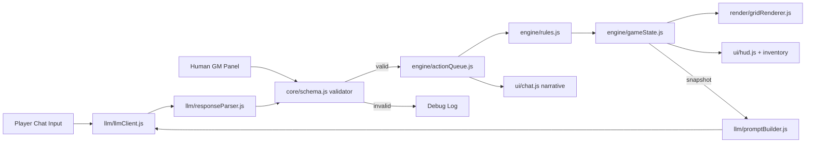

# RPG_LLM PoC — 4-Week Agile Development Plan

LLM-as-Game-Master RPG. Player types natural language → LLM returns strict JSON (`narrative` + `commands`) → validated → pushed into an **Action Queue** → a 2D grid renderer applies it. A **Human GM Mode** panel injects the same JSON payloads manually for zero-cost testing.

**Stack constraint:** pure static web (HTML + CSS + vanilla JavaScript ES modules + Canvas 2D). No server, no build step, no npm dependencies. Deployable to any static host (GitHub Pages, Netlify drop, local static preview).

---

## User Review Required

> [!IMPORTANT]
> **"Backend" without a server.** The Backend/LLM layer is a browser-side module (`src/llm/`) that calls the LLM provider directly via `fetch`. The API key is typed by the user at runtime and kept in `localStorage` — never committed. Acceptable for a PoC; **not** acceptable for public production.

> [!IMPORTANT]
> **Engine is the rules authority.** The LLM *proposes* commands; the engine *validates* them (walls, range, HP bounds, item existence). Invalid commands are rejected and logged, never applied. This keeps the game state consistent regardless of LLM hallucinations.

> [!WARNING]
> **Out of scope (anti-feature-creep):** save/load, multiple maps, procedural generation, character creation, stats beyond HP/ATK, sprites/animation polish, audio, multiplayer, streaming responses, memory/RAG.

---

## Open Questions

> [!IMPORTANT]
> 1. **LLM provider:** default proposal is **Google Gemini** (native browser CORS + JSON mode via `responseMimeType: "application/json"`). OpenAI and Anthropic also work from the browser and can be added as adapters. Which one do you want first?
> 2. **Opening locally:** ES modules do **not** load from `file://` in Chrome. Options: (a) ES modules + any static preview (VS Code "Live Server", GitHub Pages) — **recommended**; (b) classic `<script>` tags with a global namespace so `index.html` opens by double-click. Which do you prefer?
> 3. **Narrative language:** PT-BR or English?
> 4. **Execution scope after approval:** should I implement **Sprint 1 only** (then review), or build the **full PoC** following all 4 sprints?

---

## Architecture



**Key rule:** the LLM pipeline and the GM Panel are two interchangeable **command sources** that emit the *identical* payload into the same validator. Anything validated via GM Mode is guaranteed to work when the LLM emits it.

### JSON Contract (v1)

```json
{
  "narrative": "The goblin lunges from the shadows!",
  "commands": [
    { "type": "SPAWN",    "id": "goblin_1", "kind": "goblin", "at": { "x": 5, "y": 3 }, "hp": 8 },
    { "type": "MOVE",     "id": "player", "to": { "x": 4, "y": 3 } },
    { "type": "ATTACK",   "attacker": "player", "target": "goblin_1" },
    { "type": "DAMAGE",   "target": "goblin_1", "amount": 5 },
    { "type": "INTERACT", "actor": "player", "target": "chest_1" },
    { "type": "LOOT",     "actor": "player", "from": "chest_1", "item": { "id": "potion", "name": "Healing Potion", "qty": 1 } },
    { "type": "DESPAWN",  "id": "goblin_1" }
  ]
}
```

| Mechanic | Commands | Engine validation |
|---|---|---|
| Move | `MOVE` | in bounds, not a wall, not occupied, max N tiles |
| Fight | `ATTACK`, `DAMAGE`, `DESPAWN` | target exists, adjacency, HP clamped ≥ 0, auto-despawn at 0 |
| Interact | `INTERACT` | target exists, adjacency, interactable flag |
| Loot | `LOOT` | source opened/dead, item present in source |
| Setup | `SPAWN` | free tile, unique id |

### File Layout

```
RPG_LLM/
├── index.html              # game + GM panel layout
├── styles.css
├── src/
│   ├── main.js             # bootstrap / wiring
│   ├── core/
│   │   ├── eventBus.js     # pub/sub decoupling layer
│   │   ├── schema.js       # hand-written JSON contract validator
│   │   └── fixtures.js     # canonical mock payloads (shared by GM panel + tests)
│   ├── engine/
│   │   ├── gameState.js    # pure state + reducer (applyCommand)
│   │   ├── rules.js        # legality checks per command
│   │   ├── actionQueue.js  # sequential async execution with per-step delay
│   │   └── map.js          # static 12x12 test map
│   ├── render/
│   │   └── gridRenderer.js # Canvas 2D grid, entities, HP bars, hit flash
│   ├── ui/
│   │   ├── chat.js         # player input + narrative log
│   │   ├── hud.js          # HP, inventory
│   │   └── debugLog.js     # accepted/rejected commands, raw LLM output
│   ├── gm/
│   │   └── gmPanel.js      # Human GM Mode buttons + raw JSON editor
│   └── llm/
│       ├── llmClient.js    # provider adapter(s), fetch, timeout, retry
│       ├── promptBuilder.js# system prompt + contract + state snapshot
│       └── responseParser.js # extract/repair JSON, map errors
└── tests/
    ├── index.html          # zero-dependency browser test runner
    ├── runner.js           # tiny assert/describe implementation
    └── *.test.js           # schema, rules, reducer, queue, parser
```

---

## Sprint 1: Contract, Grid & Human GM Mode

**Goal:** Render a grid driven exclusively by validated JSON payloads injected from the Human GM panel.

**Deliverables:**
- JSON Contract v1 documented + validator.
- Static 12×12 map rendered on Canvas with player entity.
- Action Queue executing commands sequentially with visible step delay.
- Human GM Mode panel: preset buttons ("Spawn Goblin", "Move Player", "Deal 5 Damage", "Despawn") + raw JSON textarea with "Push Payload".
- Debug log showing accepted/rejected commands.
- Browser test runner with first passing tests.

**Technical Tasks:**

*Frontend*
- `index.html` two-column layout: game (canvas + narrative + HUD) | GM panel (toggle via `?gm=1` or hotkey `G`).
- `gridRenderer.js`: tiles, walls, entities (colored glyphs), HP bars, re-render on `state:changed`.
- `gmPanel.js`: buttons emit payloads from `fixtures.js`; textarea for arbitrary JSON.
- `debugLog.js`: timestamped list of payloads, per-command status.

*Backend/LLM (logic layer)*
- `schema.js`: validate envelope (`narrative: string`, `commands: array`) + per-type required fields; returns `{ ok, errors[] }`.
- `gameState.js`: pure `applyCommand(state, cmd) → newState` for `SPAWN`, `MOVE`, `DAMAGE`, `DESPAWN`.
- `actionQueue.js`: `enqueue(payload)`, processes one command at a time, awaits renderer, emits `queue:step` / `queue:idle`.
- `eventBus.js`: `on/off/emit`.
- Tests: schema valid/invalid cases, reducer per command, queue ordering.

**Integration Check:** Clicking any GM preset (or pasting a valid JSON) visibly updates the grid in order; pasting malformed JSON is rejected with a readable error and zero state change.

---

## Sprint 2: Core Mechanics & Rules Engine

**Goal:** Implement all 4 mechanics with engine-enforced rules, fully testable through GM Mode, while the LLM layer is built offline against fixtures.

**Deliverables:**
- Move, Fight, Interact, Loot fully functional with rule validation.
- Inventory and HP HUD.
- Expanded GM presets covering every command + illegal-case presets (move into wall, attack non-adjacent).
- LLM client + prompt builder + response parser implemented and unit-tested **without** real API calls.

**Technical Tasks:**

*Frontend*
- HUD: player HP bar, inventory list.
- Renderer: chests (closed/opened), hit flash on `DAMAGE`, fade on `DESPAWN`.
- GM panel: presets for `ATTACK`, `INTERACT`, `LOOT`, plus "Illegal Move", "Attack Out of Range", "Loot Missing Item".
- Map: place 1 chest, 2 goblin spawn points.

*Backend/LLM*
- `rules.js`: legality checks per table above; reducer only applies commands that pass.
- `ATTACK` resolution: engine computes damage from ATK (deterministic for testability) when LLM omits `DAMAGE`.
- Auto-`DESPAWN` + drop loot container at HP 0; game-over flag at player HP 0.
- `promptBuilder.js`: system prompt (role, contract, allowed command list, rules summary, "output JSON only") + compact state snapshot (map legend, entities, inventory, last 6 turns).
- `responseParser.js`: strip code fences, extract first JSON object, validate, return typed errors.
- `llmClient.js`: provider adapter interface `send(messages) → text`; mock adapter returning fixtures.
- Tests: every rule (legal + illegal), parser on dirty outputs (fenced, trailing text, invalid JSON).

**Integration Check:** A full scripted scenario run purely from GM Mode — spawn goblin → move adjacent → attack until death → open chest → loot potion — ends with the correct state; every illegal preset is rejected and logged. Mock LLM adapter output flows through parser → validator → queue identically.

---

## Sprint 3: LLM End-to-End Pipeline

**Goal:** Player natural-language input drives the game through a real LLM call with robust handling of invalid output.

**Deliverables:**
- Chat input wired to real LLM provider.
- API key settings modal (stored in `localStorage`, masked).
- JSON mode enabled + one-shot repair retry on invalid output.
- Rejected-command feedback loop (engine rejections included in next prompt).
- Raw LLM request/response visible in debug log.

**Technical Tasks:**

*Frontend*
- `chat.js`: input box, submit on Enter, disabled while request in flight, "GM is thinking…" indicator.
- Narrative rendered before/while queue executes commands.
- Settings modal: provider, model, API key, temperature.
- Toggle "Mock LLM" vs "Live LLM" for cheap iteration.

*Backend/LLM*
- Real provider adapter (per Open Question #1) with timeout (20 s) and error mapping (401, 429, network).
- Repair pass: on parse/schema failure, re-send once with the validation errors appended; on second failure show fallback narrative and apply no commands.
- Include engine rejections from previous turn in prompt ("Command X rejected: wall at 3,4").
- Few-shot examples in system prompt (1 per mechanic).
- Token guard: cap history window, truncate snapshot.

**Integration Check:** Typing "I walk toward the goblin and attack it", "I open the chest", "I take what's inside" produces valid JSON, correct grid updates, and coherent narrative; forcing an invalid response (mock adapter) triggers the repair path without corrupting state.

---

## Sprint 4: Hardening & Demo

**Goal:** Stabilize the pipeline and ship a reproducible demo build.

**Deliverables:**
- Golden-fixture regression suite (recorded real LLM responses replayed through the pipeline).
- Session log export (JSON) + replay into GM Mode.
- Demo scenario: 1 map, 2 goblins, 1 chest, win/lose conditions.
- Static deployment (GitHub Pages or equivalent) + README with setup and contract spec.
- Measured metrics: JSON validity rate, rejection rate, avg latency.

**Technical Tasks:**

*Frontend*
- Win/lose overlay and "Restart" button.
- Export/Import session log; "Replay" pushes logged payloads through GM path.
- UX polish limited to readability: error toasts, queue progress indicator.

*Backend/LLM*
- Record 20+ real responses as fixtures; regression tests assert they parse and apply.
- Metrics counter in debug log (valid/invalid/repaired/rejected per session).
- Prompt tuning pass based on rejection log (top 3 failure modes only).
- Bug bash: 30-turn play session, fix blockers only.

**Integration Check:** A fresh user opens the deployed URL, enters an API key, and completes the demo scenario end-to-end via natural language; the same session exported and replayed through GM Mode reproduces the identical final state.

---

## Verification Plan

### Automated Tests
- Open `tests/index.html` via static preview → runner prints pass/fail per suite (schema, rules, reducer, queue, parser, golden fixtures). Target: 100% pass before each sprint closes.

### Manual Verification
- **Sprint 1–2:** run the GM scripted scenario and illegal-case presets; confirm grid, HUD and debug log.
- **Sprint 3:** run the 3-sentence natural-language script with Live LLM; force invalid output with Mock LLM.
- **Sprint 4:** full demo playthrough on deployed URL + export/replay determinism check.
